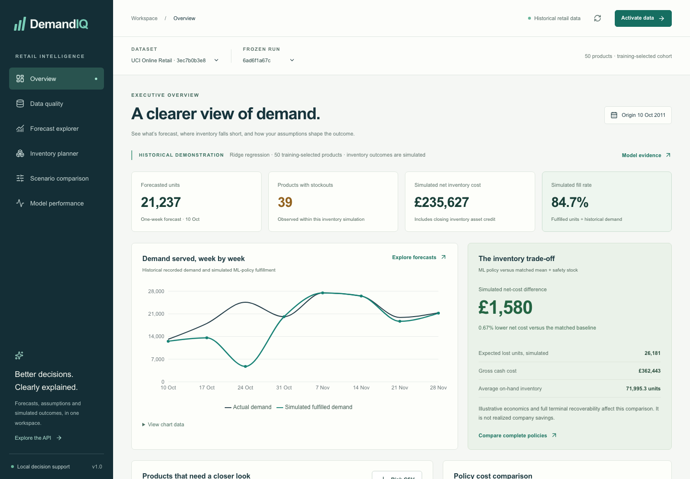

# DemandIQ

**An independent sales forecasting and inventory decision-support project.** DemandIQ turns retail transactions into weekly product forecasts, constrained replenishment recommendations and chronological inventory-policy simulations.

This is a local analytical application and portfolio project, **not a deployed business system**. Its historical experiments use UCI Online Retail; its stock, supplier and cost inputs are assumptions. It does not send purchase orders or establish savings achieved by a company.



## Problem and workflow

Retailers balance stockouts against excess inventory. DemandIQ makes that trade-off inspectable instead of treating forecast accuracy as the complete business objective:

```text
Transactions → audited cleaning → continuous product-week sales
             → chronological model comparison → forecasts and empirical intervals
             → stock/lead-time/cost assumptions → inventory simulation → CSV reports
```

The six React pages cover Overview, Data quality, Forecast explorer, Inventory planner, Scenario comparison and Model performance. Forecasts, recorded observations, user assumptions and simulated outcomes remain separately labeled. The backend provides documented APIs, PostgreSQL persistence and a durable job worker.

## What the measured results show

The frozen historical experiment selected Ridge using earlier validation data. It was not reselected after observing the final test.

| Forecast method | Selection-validation WAPE | Final-test WAPE |
| --- | ---: | ---: |
| Four-week mean | 60.22% | **51.97%** |
| Ridge regression | **53.52%** | 52.75% |
| Random Forest | 59.05% | 55.80% |
| XGBoost | 59.17% | 53.04% |

Lower WAPE is better. **Ridge did not beat the four-week mean on final-test point accuracy.** Naive and four-week-recurrence baselines are also evaluated. The complete six-method results, MAE/RMSE/sMAPE/bias, split protocol and uncertainty limitations are in the [model card](docs/MODEL_CARD.md).

Under the original illustrative inventory assumptions, the matched-policy simulation produced:

| Measure | Ridge + safety stock | Four-week mean + safety stock |
| --- | ---: | ---: |
| Modeled net inventory cost, GBP | 194,633.74 | 199,496.02 |
| Simulated fill rate | 96.37% | 94.49% |
| Average total on-hand units | **65,510.875** | **55,387.625** |

The roughly **2.4% modeled net-cost difference** is GBP 4,862.28 relative to the matched mean/safety-stock policy over eight historical weeks and 50 products. It uses assumed costs, method-specific error buffers and full purchase-cost recovery of closing stock/pipeline. The Ridge policy holds **higher stock levels**. These are simulated comparisons, **not real company savings** or proof that ML forecast accuracy improved. Raising the assumed holding cost to 0.10/unit/week in an exploratory sensitivity reversed the comparison: Ridge cost GBP 1,616.60 more. See [inventory results](docs/PHASE4_RESULTS.md).

The screenshots show actual application output. Some follow a separately configured lead-time sensitivity, so their KPIs differ from the default table above. [Screenshot context and gallery](docs/screenshots/README.md).

## Data source, terms and publication policy

Chen, D. (2015). *Online Retail* [Dataset]. UCI Machine Learning Repository. [DOI: 10.24432/C5BW33](https://doi.org/10.24432/C5BW33). The [official dataset page](https://archive.ics.uci.edu/dataset/352/online+retail) lists **CC BY 4.0**. Redistribution/adaptation requires attribution, a license link and notice of changes; it does not imply endorsement.

The full source has 541,909 transaction rows, covering December 2010–December 2011. **Raw/processed datasets, customer identifiers/pseudonyms, fitted models, generated analytical artifacts, databases and local bundles are excluded from Git.** Although the dataset license permits attributed redistribution, this repository retrieves it from UCI instead of republishing the workbook or customer-level data. [Dataset attribution and terms](docs/DATA_LICENSE.md).

The checked-in [175-row synthetic fixture](fixtures/README.md) contains three fictional products, empty customer IDs and no UCI records. It supports a small reproducible demonstration. Its model metrics and simulated costs are **not evidence of retail performance**.

After Python setup, obtain the official dataset with:

```bash
python -m scripts.download_data --expected-sha256 f5385cbb54bbebf7196389109c6b0621faab0c304e3702548165e71c84aede8b
python -m scripts.ingest_data --input 'data/raw/uci-online-retail/Online Retail.xlsx'
```

The digest pins the verified official ZIP version. If the upstream file changes, investigate the provenance rather than bypassing the check. Local compatible CSV/XLSX files are also supported.

## From transactions to weekly sales

Cleaning validates the eight source fields, explicitly parses dates, normalizes identifiers, removes exact source duplicates, quarantines invalid records and separates purchases, C-prefixed cancellations and other returns. Missing optional customer/description fields are flagged rather than silently discarding valid demand. Every row has an audited disposition. The official verified cleaning accepted 531,240 records across the movement classes.

For each eligible product, full Monday–Sunday weeks contain gross units, returned/cancelled units, net units, revenue, transactions, known unique customers and average price. Missing sales weeks are zero-filled. Gross positive purchase units are the initial target. Partial edge weeks are excluded. Zero recorded sales do not prove zero unconstrained demand or that stock was available.

The default cohort is the top **50 training-volume products**, configurable with `--top-products`/`TOP_PRODUCTS`. Selection is repeated within each training boundary and never uses future test volume. [Cleaning](docs/DATA_PIPELINE.md), [dictionary](docs/DATA_DICTIONARY.md), [weekly methodology](docs/FORECASTING_METHODOLOGY.md).

## Models and chronological validation

Baselines are last observed demand, four-week moving average and an explicitly assumed four-week seasonal recurrence. ML compares Ridge, Random Forest and XGBoost with seed 42. Features include shifted lags/rolling statistics, prior revenue/price/transactions/known-customer counts, prior credit rates, product identity and calendar fields. Imputation, scaling and encoding fit inside each training boundary.

- Initial training weeks: **2010-12-06–2011-07-11**.
- Expanding selection folds: **2011-07-18–2011-09-05**.
- Separate residual calibration: **2011-09-12–2011-10-03**.
- Frozen final test: **2011-10-10–2011-11-28**.

The completed test consists of rolling **one-week-ahead** forecasts, not a single eight-week-ahead forecast. Earlier completed test observations can supply later lags; models and the final cohort do not refit on test results. The final test has already been consumed: preserve its ledger and frozen choices. New tuning needs new evaluation data. The public synthetic demo has its **own** dataset identity and ledger.

MAE, RMSE, WAPE, sMAPE and signed bias are reported by method/product/week/volume segment. Nominal 80% uncertainty uses separate pretest scaled residuals, without a future-coverage guarantee. Ridge's historical test coverage was 79.5%, with wide mean interval width of 738.34 units. Annual seasonality and new-product/long-tail quality are not established by this short high-volume sample. [ML methodology](docs/ML_METHODOLOGY.md).

## Inventory planning and simulation

Inputs include on-hand/on-order stock, lead/review periods, service target, purchase/selling prices, holding/stockout/order costs, MOQ, case packs and capacity. Recommendations use inventory position, lead-time demand, safety stock and an order-up-to target, then enforce physical constraints. This is a **rule-based controller**, not an optimizer that minimizes costs; economic inputs score outcomes rather than directly selecting order quantities.

The chronological simulator receives due orders, observes demand, fulfills available units, records lost units/ending stock and reviews replenishment. Five policies share the same starting conditions: previous demand, four-week mean, fixed reorder point, selected ML with safety stock and matched mean with safety stock. It reports fill rate, stockouts, inventory exposure, cash/holding/penalty/order costs and terminal-adjusted cost.

Orders reviewed after demand at week `t` with lead `L` arrive before demand at `t+L+1`; `L=1` waits one complete future demand week. Longer forecast horizons use an explicit flat carry-forward approximation. Assumed 95% service is not a guarantee. Preview risk is a normal approximation, and simulated lost demand uses recorded purchases as hypothetical demand. [Formulas and accounting](docs/INVENTORY_METHODOLOGY.md).

## Local setup

Required: **Python 3.12**, **Docker Desktop/Engine with Compose**, and **Node 24.15–24.x/npm** for host frontend development. PostgreSQL 16.6, Python, Node and Nginx are supplied by the Compose images for containerized services. Git is needed to clone this project.

```bash
git clone https://github.com/sahib44/demandiq.git
cd demandiq
python3.12 -m venv .venv
source .venv/bin/activate
python -m pip install -r requirements-dev.lock
python -m pip install --no-deps --no-build-isolation -e .
cp .env.example .env
```

Replace `CHANGE_ME_LOCAL_ONLY` consistently in the ignored `.env` password and native database URLs with a URL-safe local password. Never commit credentials. On macOS, XGBoost needs OpenMP (`brew install libomp`), or use the documented checksum-pinned local helper:

```bash
python -m scripts.setup_macos_openmp
export DYLD_LIBRARY_PATH="$PWD/.cache/libomp"
```

The helper is for supported Apple Silicon macOS versions; other systems should install their platform's OpenMP runtime. The lock/build was exercised on macOS/Linux ARM64. AMD64 execution is not yet verified.

### Small, entirely synthetic demonstration

From the project root in the installed Python environment:

```bash
python -m scripts.demo_synthetic
DEMANDIQ_DEMO_BUNDLE_DIR=./.cache/synthetic-demo/bundle docker compose -p demandiq-synthetic --profile demo up --build
```

The first command genuinely cleans the fictional fixture, trains/calibrates the normal three model families and baselines, evaluates **only the separate synthetic dataset**, and prepares an ignored local bundle. All generated files stay under `.cache/synthetic-demo/`. The second command runs the local API, worker, database, frontend and bootstrap against that bundle. It performs no public/cloud deployment. Use unused `POSTGRES_PORT`, `API_PORT`, `FRONTEND_PORT` values if another local stack occupies the defaults.

Open [the dashboard](http://127.0.0.1:8080) and [API docs](http://127.0.0.1:8080/api/docs). Synthetic workspaces display a fictional-data notice. **Do not click “Activate historical sample” for this synthetic workspace**: that button requires the separate trusted official artifacts, which are not in Git. The bootstrap activates the synthetic workspace automatically.

Stop while retaining its volumes:

```bash
DEMANDIQ_DEMO_BUNDLE_DIR=./.cache/synthetic-demo/bundle docker compose -p demandiq-synthetic --profile demo stop
```

`docker compose up --build` without a populated bundle starts an honest empty application. Reproducing the full official experiment requires downloading/ingesting UCI, chronological training and preserving its completed evaluation outputs locally; see [development commands](docs/DEVELOPMENT.md) and [delivery/backup](docs/DELIVERY.md). Official models/ledgers cannot be reconstructed from screenshots or synthetic results.

### Native development

With PostgreSQL started and the ignored `.env` loaded, migrate and run API/worker in separate terminals:

```bash
set -a; source .env; set +a
docker compose up -d postgres
python -m alembic -c backend/alembic.ini upgrade head
python -m uvicorn backend.app.main:app --host 127.0.0.1 --port 8000 --no-access-log
# Separate terminal, same environment:
python -m scripts.run_worker
# Frontend terminal:
cd frontend
npm ci
npm run dev
```

Vite serves port 5173 and proxies `/api` to localhost:8000. `VITE_API_BASE_URL` is a public build setting; `API_PROXY_TARGET` changes the development proxy. Export settings or use ignored `frontend/.env.local`; Vite does not automatically load the root `.env`. Other variables and defaults are in [.env.example](.env.example).

## Tests and verification

```bash
# Python unit/analytical tests (no database):
python -m pytest ml/tests backend/tests -m 'not integration'
python -m ruff check .
python -m black --check .
python -m pip check
# Full suite: TEST_DATABASE_URL must point to a disposable database ending _test.
# The Compose initializer creates demandiq_test on a fresh database volume.
python -m pytest ml/tests backend/tests
# Frontend, from frontend/:
npm ci
npm test
npm run lint
npm run format:check
npm run build
npx playwright install chromium
PLAYWRIGHT_BASE_URL=http://127.0.0.1:8080 npm run test:e2e
```

The existing Playwright workflow targets the **full official historical demo** and its 50-product cohort; the three-product synthetic demo is verified separately and is not a substitute for those assertions. Database tests are explicitly skipped without `TEST_DATABASE_URL`; skips are not database passes. Do not run destructive integration fixtures against an operating database.

Recorded Phase 6 verification: **1,250 Python tests**, **28 component tests**, **3 real-backend Playwright tests**, and twelve desktop/mobile axe scans with zero violations. Publication adds synthetic-fixture safety tests and a visible synthetic-data notice. Current rerun counts/results and security checks are recorded in [the publication report](docs/PUBLICATION_REPORT.md). Synthetic fixtures test behavior, never substantiate real metrics or savings.

## Architecture, documentation and limits

- Python: pandas/NumPy/PyArrow, scikit-learn/XGBoost, joblib and Matplotlib.
- API/persistence: FastAPI, Pydantic, SQLAlchemy, Alembic, PostgreSQL and leased jobs with idempotency/bounded retries.
- UI: React/TypeScript/Vite, Recharts, native accessible controls and responsive CSS.
- Delivery/quality: Docker Compose, Nginx, pytest, Vitest/RTL, Playwright/axe, Ruff/Black and ESLint/Prettier.

Read the [architecture](docs/BACKEND_ARCHITECTURE.md), [API](docs/API.md), [user guide](docs/USER_GUIDE.md), [model card](docs/MODEL_CARD.md), [worked scenario](docs/EXAMPLE_SCENARIO.md) and [screenshots](docs/screenshots/README.md).

This is a trusted local, single-location project without authentication, cloud hosting, supplier integrations or automated purchasing. Historical sales can be censored by unknown stock availability. Lead times/costs are assumed, uncertainty transfers across products, and terminal stock may not recover its full value in practice. Performance on current retailers, other platforms/browsers, low-volume or new products, and production load is not established. Completed evaluation ledgers and coordinated database/artifact backups must be preserved.
